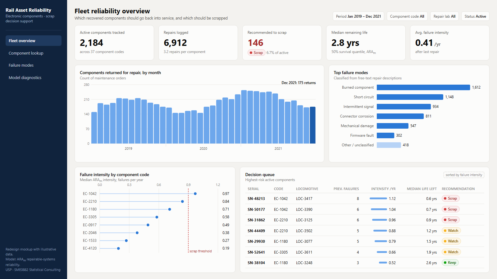
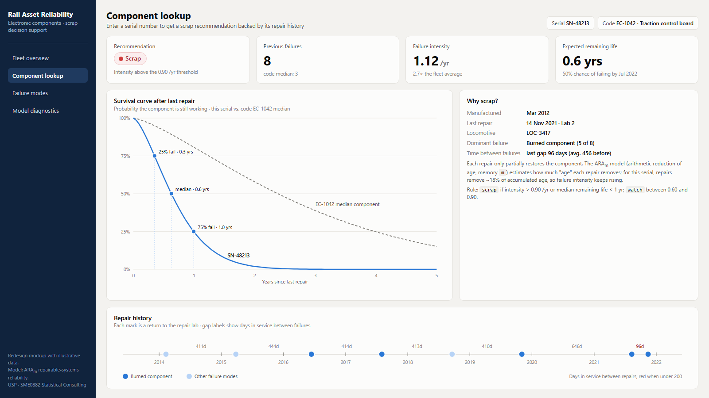
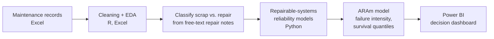

# Scrap-or-Repair Decision Model for Locomotive Electronics

A statistical consulting project for a **railway logistics operator** in Brazil (1,600+ km of track across three states). Electronic components that fail on locomotives are repaired and put back into circulation, but there was no objective rule for when a part should be **scrapped** instead. Technicians decided case by case.

We built a reliability model that scores each component from its repair history and recommends whether to **scrap** it, plus a Power BI dashboard to put that recommendation in front of the maintenance team.

**Course:** SME0882 Statistical Consulting, Universidade de São Paulo (ICMC). Real client, real data, one semester, team of students. **My role:** data preparation and the Power BI dashboard.

## Dashboard (redesign)

> **Note:** these screens are a redesign mockup built on the same data model as the original Power BI report (component series, failure counts, ARAm failure intensity, life expectancy and 25/50/75% survival quantiles). **The values are illustrative**, not the client's data. Source: [`docs/mockup/scrap-dashboard.html`](docs/mockup/scrap-dashboard.html).

## The problem

- Recovered components go back into service with no standard rule for retiring them, so the decision depends on the technician.
- The database had a *Scrapped / Recovered* status field, but many parts marked "scrapped" later came back into service. **The label was unreliable.**
- The real signal sat in **free-text fields**: the failure description and the repair description.

## Approach

1. **Data preparation.** Standardized serial numbers and component codes, computed time between repairs, and rebuilt the scrap label from keywords in the repair descriptions instead of trusting the status field.
2. **Exploratory analysis.** Return rates by component code, the most common failure modes, and repairs per locomotive.
3. **Modeling.** A repaired component is neither "as good as new" nor "as bad as old", so we used **repairable-systems** models from survival and reliability analysis. After comparing alternatives we chose **ARAm** (Arithmetic Reduction of Age with memory *m*). It estimates how much each repair rejuvenates a part, which gives a failure intensity, an expected remaining life and survival quantiles for every serial number.
4. **Decision support.** The model output drives a scrap-or-keep recommendation per component, shown in an automated Power BI dashboard with filters by component code, repair lab and status. The redesign adds a "watch" band for borderline parts.

## Repository

| File | Contents |
|---|---|
| [`consultoria_estatística_grupo_5.py`](consultoria_estatística_grupo_5.py) | Python analysis (pandas, seaborn): cleaning, EDA and modeling |
| `Sucateamento de Componentes Eletrônicos.pbip` / `.pbix` | Original Power BI report and data model |
| `Consultoria Estatística - Grupo 5.pdf` | Final presentation delivered to the class and the client (Portuguese) |
| [`docs/`](docs/) | Dashboard redesign images and HTML source |

## What I took from it

- Working with a real client: messy data, labels you can't trust, and a business question that has to become a statistical one.
- The difference between a model that's statistically right and a recommendation people can actually act on, which is why the dashboard mattered.
- Leading the BI deliverable inside a multidisciplinary team.
